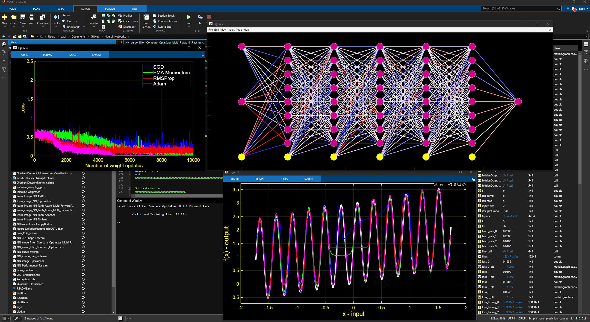

# Neural Networks from Scratch in MATLAB

Neural networks, their training algorithms and evolutionary methods, implemented from scratch in MATLAB without the Deep Learning Toolbox. Forward pass, backpropagation, the optimizers and the visualisations are all written by hand, with gradient checks to verify the backpropagation.

## Highlights

| Script | Description |
| --- | --- |
| [`NEUroEvolutionFlappyBird.m`](NEUroEvolutionFlappyBird.m) | A population of 500 small neural networks learns to play a Flappy-Bird-style game through neuroevolution: a genetic algorithm with fitness-based selection and mutation, without any backpropagation. |
| [`NN_curve_fitter_Compare_Optimizer_Multi_Forward_Pass.m`](NN_curve_fitter_Compare_Optimizer_Multi_Forward_Pass.m) | Four identical deep networks are trained side by side on the same curve-fitting task to compare SGD, momentum, RMSProp and Adam, using a vectorised mini-batch forward and backward pass. |
| [`learn_image_NN_Tanh_Adam_Multi_ForwardPass.m`](learn_image_NN_Tanh_Adam_Multi_ForwardPass.m) | A tanh network with Fourier-feature inputs learns to reproduce an image from its pixel coordinates, trained with Adam and shown live together with the evolving network weights. |
| [`Quadrant_Classifier.m`](Quadrant_Classifier.m) | A dense network trained with backpropagation and momentum classifies whether 2D points lie inside a central square, plotting its decision surface live during training. |
| [`NN_image_upscaler.m`](NN_image_upscaler.m) | A Fourier-feature network learns a downsampled photo as a continuous function of the pixel coordinates, then upscales it 2x by evaluating on a finer grid, validated against the original image and bicubic interpolation. |

## Other contents

| Folder / files | Description |
| --- | --- |
| `PINNs/` | Physics-informed neural networks for batch and fed-batch reactor models and state observers |
| `GeneticAlgorithms/` | Genetic algorithms: image reconstruction from shapes, travelling salesman, text generation |
| `CNN/` | First steps towards convolutional networks |
| `*.mlx` | Live scripts on perceptrons, XOR, gradient descent and weight initialisation |
| `feedForward*.m`, `backProp*.m`, `check_gradients*.m`, ... | Shared building blocks: forward pass, backpropagation, gradient checks, activation functions, weight initialisation |
